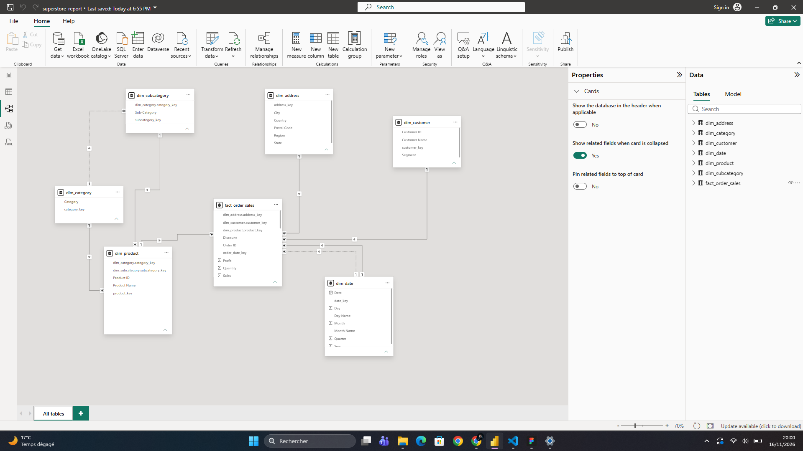
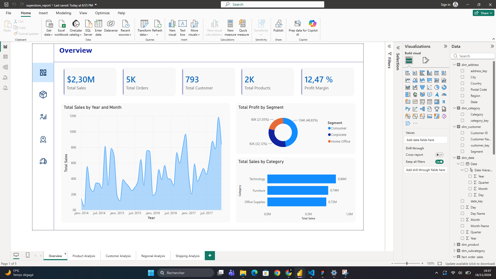
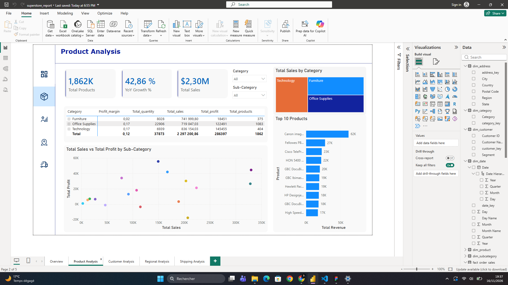
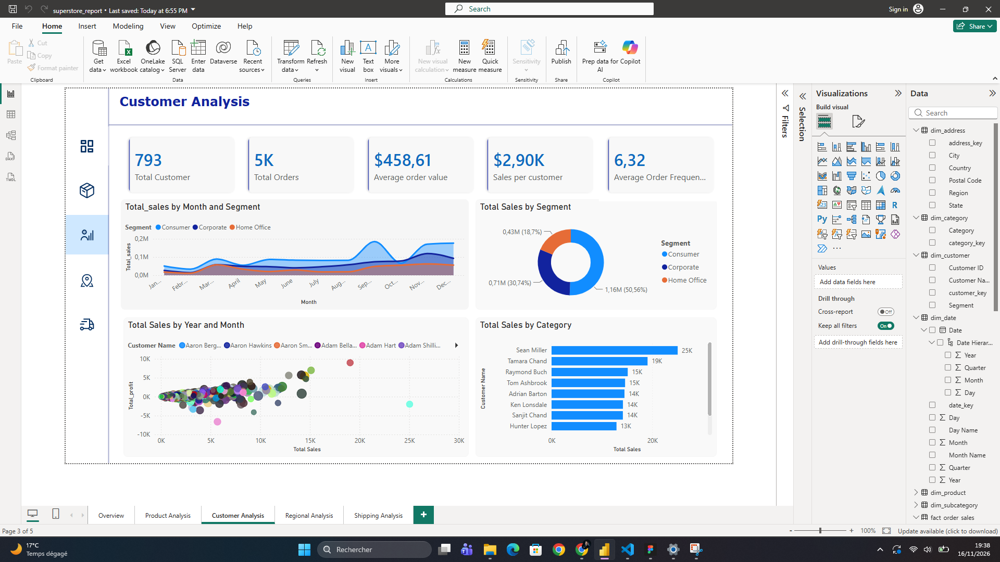
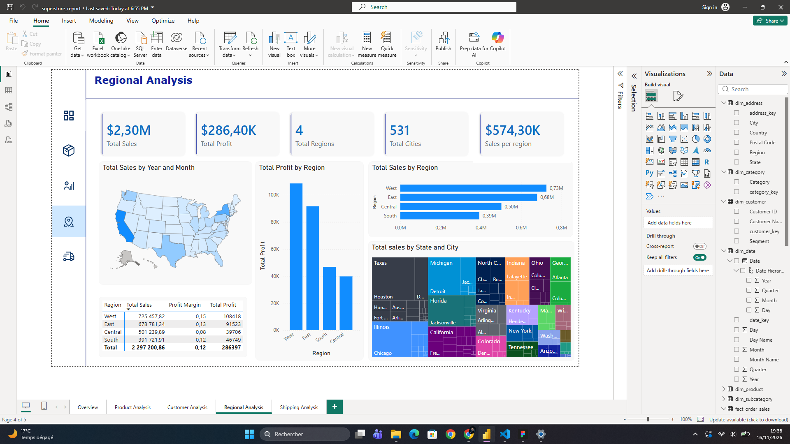
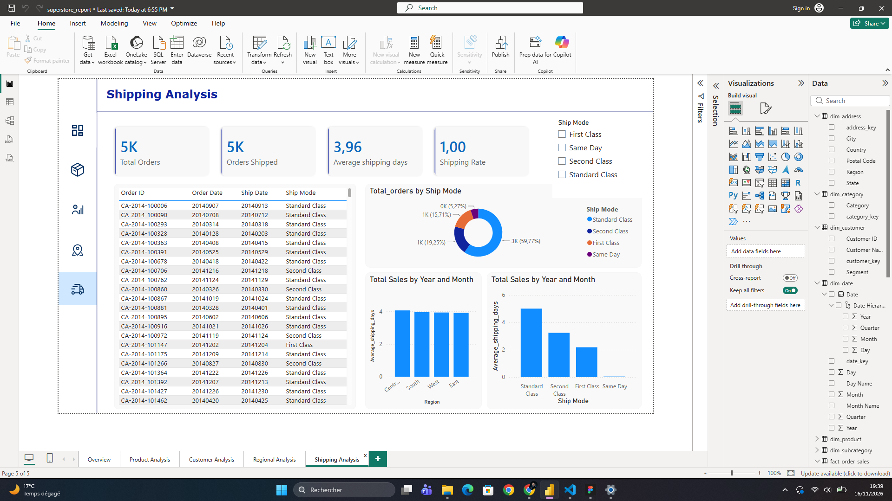

# Superstore Sales Analysis | Power BI

An end-to-end Data Analytics project using **Microsoft Power BI** to transform raw sales data into an interactive dashboard and generate business insights.

The project covers data preparation, data modeling, DAX calculations, and data visualization. It was also an opportunity to apply data analysis concepts learned at university and through self-learning.

---

## 📌 Table of Contents

- [Project Overview](#-project-overview)
- [Project Objectives](#-project-objectives)
- [Tools and Technologies](#-tools-and-technologies)
- [Dataset](#-dataset)
- [Project Workflow](#-project-workflow)
- [Data Preparation](#1-data-preparation)
- [Data Modeling](#2-data-modeling)
- [DAX and Measures](#3-dax-and-measures)
- [Data Visualization](#4-data-visualization)
- [Business Questions](#-business-questions)
- [Project Structure](#-project-structure)
- [How to Run the Project](#-how-to-run-the-project)
- [What I Learned](#-what-i-learned)
- [References](#-references)

---

## 📊 Project Overview

The Superstore Sales Analysis project focuses on analyzing sales data to understand business performance and support better decision-making.

I started with a single CSV file containing all the information in one table. Instead of using the original structure directly, I explored different data modeling approaches and reorganized the data into fact and dimension tables.

I then used Power BI to prepare the data, build relationships, create DAX measures, and develop interactive visualizations.

The final result is an interactive dashboard that helps explore different aspects of business performance.

## 🎯 Project Objectives

- Understand and explore raw sales data.
- Clean and transform data using Power Query.
- Understand and apply relational data modeling concepts.
- Build a data model using fact and dimension tables.
- Explore Star Schema and Snowflake Schema approaches.
- Create measures using DAX.
- Analyze sales and business performance.
- Build interactive dashboards to answer business questions.

## 🛠️ Tools and Technologies

| Tool | Purpose |
|---|---|
| Microsoft Power BI Desktop | Data modeling, analysis, and visualization |
| Power Query | Data cleaning and transformation |
| DAX | Calculations and analytical measures |
| CSV | Original data source |
| GitHub | Project documentation and version control |

## 📁 Dataset

The project uses the Superstore dataset, provided in CSV format.

The original dataset contains sales-related information, including:

- Orders and order dates
- Customers and customer segments
- Products and product categories
- Sales and profit
- Quantity and discounts
- Shipping information
- Address information

**Original dataset:** https://www.kaggle.com/datasets/vivek468/superstore-dataset-final

The original data was provided as a single table. The main objective was to transform this flat structure into a more organized analytical data model.

---

## 🔄 Project Workflow

The project follows these main steps:

1. Data exploration and understanding
2. Data cleaning and transformation
3. Data modeling
4. DAX measures and calculations
5. Data visualization
6. Business analysis and insights

---

## 1. Data Preparation

**Tool: Power Query**

Power Query is a data preparation and transformation tool integrated into Power BI.

It allows users to connect to different data sources, clean data, transform columns, and prepare datasets before loading them into the data model.

### Transformations performed

- Created new columns.
- Split columns into multiple columns.
- Merged and concatenated columns.
- Removed unnecessary columns.
- Changed column names and data types.
- Extracted information from existing columns.
- Created separate queries to build fact and dimension tables.

I also explored different approaches to create dimension tables and the fact table from the original CSV source.

## 2. Data Modeling

Data modeling is the process of organizing data into tables and defining relationships between them.

A good data model improves the structure of the data, simplifies calculations, and makes reports easier to maintain.

### Star Schema

A Star Schema is a data modeling approach where a central fact table is connected directly to several dimension tables.

The fact table contains measurable business events, while dimension tables provide descriptive information.

For example:

- Fact table: Order Sales
- Dimensions: Customer, Product, Date, Address, and Shipping.

This structure is simple and efficient for analytical queries.

### Snowflake Schema

A Snowflake Schema is an extension of the Star Schema.

In this approach, some dimension tables are divided into smaller related tables to reduce data duplication and organize hierarchical information.

For example, product information can be organized using the following hierarchy:

**Category → Sub-Category → Product**

Instead of storing all product hierarchy information in one dimension table, the tables are separated and connected through relationships.

### My Data Modeling Approach

I started by exploring the Star Schema approach and then developed the model into a Snowflake Schema by normalizing part of the product dimension.

The final model includes:

- One central fact table: `fact_order_sales`
- Multiple dimension tables.
- Relationships between fact and dimension tables.
- A separate product hierarchy involving Category, Sub-Category, and Product.

This approach helped me understand the differences between the two schemas and how data modeling decisions affect the analytical model.

### Data Model




## 3. DAX and Measures

**DAX (Data Analysis Expressions)** is a formula language used in Power BI to create calculations and measures.

It allows users to perform aggregations, apply filters, calculate business metrics, and analyze data.

### Measures

I created DAX measures to calculate and analyze business performance.

Examples of common analytical measures include:

| Measure | Description |
|---|---|
| Total Sales | Total revenue generated from sales |
| Total Profit | Total profit generated |
| Total Orders | Number of orders |
| Total Customers | Number of unique customers |
| Total Quantity | Total quantity of products sold |
| Average Order Value | Average sales value per order |

These measures can be reused across different visualizations and respond dynamically to report filters and slicers.

### Calculated Columns vs. Measures

Power BI provides two important ways to create calculations:

**Calculated Columns**
- Calculated for each row in a table.
- Stored in the data model.
- Useful for creating categories or additional attributes.

**Measures**
- Calculated dynamically based on the filter context.
- Not stored as individual row values.
- Useful for aggregations and business KPIs.

In this project, I used DAX measures to support the analysis and build interactive reports.

## 4. Data Visualization

Data visualization helps transform analytical results into information that is easier to understand.

I used different Power BI visuals to explore the data and communicate business performance.

Visuals include:

- Bar charts
- Column charts
- Line charts
- Scatter plots
- Cards and KPI indicators
- Tables and matrices
- Maps
- Slicers and filters

The dashboard is organized into different analytical sections to make navigation and exploration easier.

### Dashboard Pages

Add screenshots of your actual report pages below.

#### Sales Analysis



#### Product Analysis



#### Customer Analysis



#### Regional Analysis



#### Shipping Analysis



---

## 💡 Business Questions

The dashboard was designed to answer different business questions and support analytical thinking.

### Sales Analysis
- What is the total sales and profit?
- How do sales change over time?
- Which periods generate the highest sales?
- What is the average order value?

### Product Analysis
- Which product categories generate the most revenue?
- Which products are the most profitable?
- How do discounts affect sales and profit?
- Which products have low or negative profitability?

### Customer Analysis
- How many unique customers are there?
- Which customer segments generate the most sales?
- Who are the highest-value customers?
- How is customer purchasing behavior distributed?

### Regional Analysis
- Which regions generate the highest revenue?
- How does business performance vary across different locations?
- Which geographical areas have the highest profit?

### Shipping Analysis
- What is the average shipping time?
- How do shipping methods affect delivery time?
- Which shipping methods are most frequently used?

These questions help move beyond simply displaying numbers and focus on understanding business performance.

---

## 📂 Project Structure

```text
powerbi-superstore-sales-analysis/
│
├── dataset/
│   └── superstore.csv
│
├── powerbi/
│   └── superstore-analysis.pbix
│
├── screenshots/
│   ├── data-model.png
│   ├── sales-analysis.png
│   ├── product-analysis.png
│   ├── customer-analysis.png
│   ├── regional-analysis.png
│   └── shipping-analysis.png
│
└── README.md
```

## 🚀 How to Run the Project

To explore the project on your computer:

1. Clone this repository:

   ```bash
   git clone https://github.com/YOUR_USERNAME/powerbi-superstore-sales-analysis.git
   ```

2. Open the project folder.

3. Install [Power BI Desktop](https://www.microsoft.com/en-us/power-platform/products/power-bi/desktop).

4. Open the `.pbix` file located in the `powerbi` folder.

5. If Power BI asks for the original CSV file location, update the data source path.

6. Refresh the data to load the dataset.

7. Explore the data model, DAX measures, and interactive report pages.

## 📚 What I Learned

This project helped me improve my understanding of:

- Data preparation and transformation using Power Query.
- Relational data modeling concepts.
- Differences between Star Schema and Snowflake Schema.
- Fact tables, dimension tables, and table relationships.
- DAX calculations and filter context.
- Building analytical measures and KPIs.
- Choosing the right visualizations for different business questions.
- Using analytical thinking to explore business data.
- Working with Power BI from raw data to interactive reports.

It was also an opportunity to connect theoretical concepts learned at university with practical skills developed through self-learning and different learning resources.

## 📖 References

**Microsoft Power BI Documentation**
- [Power BI Documentation](https://learn.microsoft.com/en-us/power-bi/)
- [Power Query Documentation](https://learn.microsoft.com/en-us/power-query/)
- [DAX Overview](https://learn.microsoft.com/en-us/dax/)
- [Power BI Data Modeling](https://learn.microsoft.com/en-us/power-bi/transform-model/desktop-relationships-understand)

**Data Modeling**
- [Star Schema Guidance – Microsoft](https://learn.microsoft.com/en-us/power-bi/guidance/star-schema)

---


**Abdelhafidh Hadjadj**

Master's in Computer Science | Data Science & AI


⭐ If you find this project useful, feel free to explore the repository and share your feedback.
